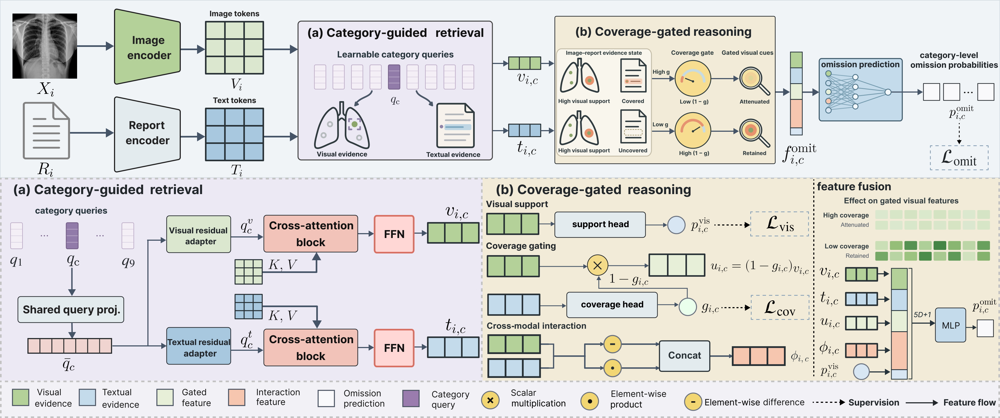

<div align="center">

# CGQ-Net

**Category-Guided Query Network**  
Category-level omission detection in chest X-ray reports

[](LICENSE)
[](docs/USAGE.md#installation)
[](requirements.txt)

[Resources](#resources) · [Quick start](#quick-start) · [Main results](#main-results) · [Data versions](#data-versions) · [Full documentation](docs/USAGE.md)

</div>

Official implementation of **CGQ-Net (Category-Guided Query Network)** for category-level omission detection in chest X-ray reports. CGQ-Net performs category-specific visual and textual evidence retrieval and coverage-gated support–coverage reasoning, trained with controlled counterfactual supervision.

## Framework

[](assets/cgq_net_architecture.pdf)

*CGQ-Net retrieves visual and textual evidence with learnable category queries, estimates visual support and report coverage, and uses coverage-gated evidence fusion to predict omissions across nine finding categories.* [View the original vector figure](assets/cgq_net_architecture.pdf).

## Resources

Code, benchmark data, and model weights are distributed separately. The repository contains the main-model implementation, configurations, validation-selected thresholds, checkpoint metadata, and synthetic-input tests.

| Resource | Location and status |
|---|---|
| Main-model code | Available in this repository; see [full usage instructions](docs/USAGE.md). |
| CXR-OMIT benchmark | Separate distribution through PhysioNet is planned. The project-specific access link will be added here. **v1 is the paper/default version**; see [data versions](#data-versions). |
| CGQ-Net paper checkpoint | Distributed separately from the code; the download link will be added here. [Checkpoint identity, SHA-256, and expected metrics](configs/paper_checkpoint.json) are available. |
| Paper thresholds | Available in [configs/thresholds_paper.json](configs/thresholds_paper.json); use with the corresponding v1 paper checkpoint. |
| Visual encoder initialization | [CXR-RePaiR ViT-B/32](https://github.com/rajpurkarlab/CXR-RePaiR); obtain `clip-imp-pretrained_128_6_after_4.pt` from the upstream project for training. |
| Text encoder and tokenizer | [BiomedVLP-CXR-BERT-specialized](https://huggingface.co/microsoft/BiomedVLP-CXR-BERT-specialized); use the model ID or a local copy. |
| Paper | The manuscript link and citation will be added when publicly available. |

Source images, report text, and benchmark Parquets are not hosted on GitHub. Access to the underlying [MIMIC-CXR](https://physionet.org/content/mimic-cxr/2.1.0/), [MIMIC-CXR-JPG](https://physionet.org/content/mimic-cxr-jpg/2.1.0/), and [CXR-LT](https://physionet.org/content/cxr-lt-iccv-workshop-cvamd/2.0.0/) resources follows their respective access requirements. The planned benchmark release will provide its own access instructions.

## Quick start

The evaluation example below requires an authorized copy of **CXR-OMIT v1** and the matching CGQ-Net paper checkpoint. Their project-specific download links are not yet listed above. The repository consumes prepared benchmark files; it does not contain the benchmark construction pipeline.

### 1. Install

Use Python 3.10 or 3.11 with a PyTorch build appropriate for your hardware. Run commands from the repository root.

```bash
git clone https://github.com/owedeeply/category-omission-detection.git
cd category-omission-detection
python -m pip install -r requirements.txt
```

### 2. Configure the data

The following shell examples use Linux/macOS syntax. Set paths to your authorized local copies:

```bash
export CXR_OMIT_ROOT=/path/to/cxr_omit_v1
export CXR_IMAGE_ROOT=/path/to/images
# Optional: use a local CXR-BERT copy instead of its Hugging Face model ID.
export CXR_BERT_PATH=/path/to/BiomedVLP-CXR-BERT-specialized
```

Leave `CXR_BERT_PATH` unset to use `microsoft/BiomedVLP-CXR-BERT-specialized` directly. Place the **v1** benchmark files under `CXR_OMIT_ROOT`:

```text
cxr_omit_v1/
├── train.parquet
├── val.parquet
└── test.parquet
```

By default, images are resolved as `CXR_IMAGE_ROOT/{train,val,test}/<image filename>`. For an existing directory tree with image paths relative to `CXR_IMAGE_ROOT`, set `data.image_path_layout: auto` in both YAML configurations. See [data configuration](docs/USAGE.md#data-configuration) for the schema and path options.

### 3. Evaluate the paper checkpoint

After obtaining the matching checkpoint, evaluate the v1 test split with the frozen validation-selected thresholds:

```bash
python evaluate.py \
  --config configs/eval.yaml \
  --checkpoint /path/to/cgq_net_seed42_epoch002.ckpt \
  --threshold-json configs/thresholds_paper.json \
  --split test \
  --output outputs/test_metrics.json
```

The command writes metrics to `outputs/test_metrics.json`. The full trained checkpoint contains the visual encoder state, so this evaluation command does not need a separate CXR-RePaiR initialization checkpoint. CXR-BERT model/tokenizer resources are still required.

### 4. Train or run inference

For training, also configure the upstream visual initialization checkpoint:

```bash
export CXR_REPAIR_CHECKPOINT=/path/to/clip-imp-pretrained_128_6_after_4.pt
python train.py --config configs/train.yaml
```

For a newly trained checkpoint, fit thresholds on the validation split before test evaluation. See [threshold fitting](docs/USAGE.md#threshold-fitting-and-evaluation) and [single-image/report inference](docs/USAGE.md#inference) for the complete commands.

## Main results

Results on the **CXR-OMIT v1 test split** with the selected paper checkpoint (training seed **42**, batch size **128**, zero-based epoch **2**) and validation-selected category thresholds:

| Model | Macro-AUPRC ↑ | Micro-AUPRC ↑ | Report-AUPRC ↑ | Macro-F1 ↑ | Clean FAR ↓ |
|---|---:|---:|---:|---:|---:|
| **CGQ-Net** | **0.6390** | **0.8034** | **0.9567** | **0.6050** | **0.1161** |

Category metrics use valid omission-mask positions. Report-AUPRC uses the maximum score over valid categories; Clean FAR is the fraction of unmodified controls with any valid category crossing its validation-selected threshold. Checkpoint selection and final evaluation use different preprocessing configurations, documented in [USAGE.md](docs/USAGE.md#threshold-fitting-and-evaluation).

Exact metric values and the checkpoint checksum are recorded in [configs/paper_checkpoint.json](configs/paper_checkpoint.json). The bundled thresholds belong to that checkpoint; refit them on validation data for a new training run.

## Data versions

| Version | Role | Relationship to this code release |
|---|---|---|
| **v1 — paper version** | Data used for the reported experiments. | **Default for training, evaluation, the paper checkpoint, and bundled thresholds.** Use the v1 train/validation/test files for paper reproduction. |
| **v2 — corrected version** | Subsequent corrections to report-coverage labels, with additional coverage-validity metadata. | A separate version intended for the data release. It was not used for the reported paper results; current code retains v1 masking behavior. |

Keep the versions in separate directories and use one version consistently across train, validation, and test. The generic filenames `train.parquet`, `val.parquet`, and `test.parquet` do not identify the version: `CXR_OMIT_ROOT` must point to your **v1** directory for the default workflow. Simply renaming v2 files does not apply its additional `coverage_valid_mask_*` fields; dedicated use of those fields would require a loader/loss update.

## Documentation and tests

- [Installation, data schema, training, threshold fitting, inference, and evaluation](docs/USAGE.md)
- [Paper training configuration](configs/train.yaml) and [final evaluation configuration](configs/eval.yaml)
- Synthetic tests that require no patient data or pretrained weights:

```bash
python -m unittest discover -s tests -v
```

## Citation

Citation information will be provided when the manuscript becomes publicly available.

## License

The code is released under the [MIT License](LICENSE). Data and pretrained model licenses apply separately.
